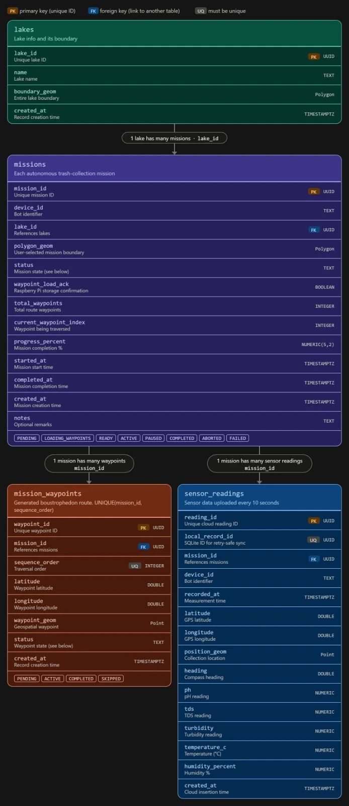

# Standard Supabase Schema — Lake Bot (backend + frontend)



**This is the single source of truth for table and column names.**
The Raspberry Pi backend (`autonomous_nav`) and the Vercel frontend must both use exactly these
tables, columns and status values. Do not add aliases, rename columns, or read/write legacy tables
(`grids`, `grid_sessions`, `mission_grids`, `sensor_samples`, `measurement_sessions`).

Migration: [`../migrations/0003_polygon_navigation_schema.sql`](../migrations/0003_polygon_navigation_schema.sql)
(idempotent; check it against the live database before running it).

---

## Request to both teams

### Backend (Raspberry Pi) — done in this repository
- [x] Writes `missions`, `mission_waypoints`, `sensor_readings` with exactly the columns below.
- [x] `mission_waypoints.status` uses `PENDING / ACTIVE / COMPLETED / SKIPPED`, and every change is synced.
- [x] `sensor_readings` is upserted on `local_record_id` (idempotent), at most one row per 10 s.
- [x] Geometry is sent as EWKT with SRID 4326; a database trigger also fills it from latitude/longitude.
- [x] No legacy table names remain (old `sensor_samples` / `measurement_sessions` fallbacks removed).

### Frontend (Vercel) — please update your repository
- [ ] Use only these table names: `lakes`, `missions`, `mission_waypoints`, `sensor_readings`.
- [ ] Use the exact column names below in Supabase queries, TypeScript types and UI code
      (e.g. `latitude`/`longitude`, not `lat`/`lng`; `sequence_order`, not `order`/`index`;
      `temperature_c`, `humidity_percent`, `progress_percent`, `current_waypoint_index`).
- [ ] Use the exact status values below (uppercase strings).
- [ ] **Read only** from Supabase with the anon key. Do **not** insert or update `missions`,
      `mission_waypoints` or `sensor_readings` from the browser. Missions are created by
      `POST /api/missions` on the Raspberry Pi, which writes Supabase with the service-role key.
- [ ] Remove any code that still uses grid tables for navigation (`grids`, `mission_grids`, `grid_sessions`).
- [ ] Copy the TypeScript types at the end of this file into the frontend (e.g. `src/types/supabase.ts`).

---

## Tables

### `lakes`
| Column | Type | Notes |
|---|---|---|
| `lake_id` | UUID | **PK** |
| `name` | TEXT | |
| `boundary_geom` | geometry(Polygon, 4326) | full lake boundary |
| `created_at` | TIMESTAMPTZ | |

### `missions` (1 lake → many missions, via `lake_id`)
| Column | Type | Notes |
|---|---|---|
| `mission_id` | UUID | **PK** — generated by the frontend, sent in `POST /api/missions` |
| `device_id` | TEXT | e.g. `BOT001` |
| `lake_id` | UUID | **FK → lakes.lake_id**, nullable |
| `polygon_geom` | geometry(Polygon, 4326) | user-selected mission boundary |
| `status` | TEXT | `PENDING`, `LOADING_WAYPOINTS`, `READY`, `ACTIVE`, `PAUSED`, `COMPLETED`, `ABORTED`, `FAILED` |
| `waypoint_load_ack` | BOOLEAN | true once the Pi has stored the waypoints locally |
| `total_waypoints` | INTEGER | |
| `current_waypoint_index` | INTEGER | waypoint currently being traversed (= `sequence_order`) |
| `progress_percent` | NUMERIC(5,2) | 0–100 |
| `started_at` | TIMESTAMPTZ | |
| `completed_at` | TIMESTAMPTZ | set for COMPLETED / ABORTED / FAILED |
| `created_at` | TIMESTAMPTZ | |
| `notes` | TEXT | pause / failure reason |

### `mission_waypoints` (1 mission → many waypoints, `UNIQUE(mission_id, sequence_order)`)
| Column | Type | Notes |
|---|---|---|
| `waypoint_id` | UUID | **PK** (database default) |
| `mission_id` | UUID | **FK → missions.mission_id** |
| `sequence_order` | INTEGER | 0 = GCS start … N = GCS return; **UQ** with `mission_id` |
| `latitude` | DOUBLE PRECISION | |
| `longitude` | DOUBLE PRECISION | |
| `waypoint_geom` | geometry(Point, 4326) | |
| `status` | TEXT | `PENDING`, `ACTIVE`, `COMPLETED`, `SKIPPED` |
| `created_at` | TIMESTAMPTZ | |

Waypoint *type* (`GCS` / `COVERAGE` / `TRANSIT`) is part of the API payload only and is not stored in
Supabase: `sequence_order = 0` and `sequence_order = total_waypoints - 1` are the GCS.

### `sensor_readings` (1 mission → many readings; one row per 10 s)
| Column | Type | Notes |
|---|---|---|
| `reading_id` | UUID | **PK** (database default) |
| `local_record_id` | UUID | **UQ** — Raspberry Pi SQLite id, idempotency key for retries |
| `mission_id` | UUID | **FK → missions.mission_id**, nullable (no active mission) |
| `device_id` | TEXT | |
| `recorded_at` | TIMESTAMPTZ | measurement time |
| `latitude` | DOUBLE PRECISION | nullable (no GPS fix) |
| `longitude` | DOUBLE PRECISION | nullable |
| `position_geom` | geometry(Point, 4326) | nullable |
| `heading` | DOUBLE PRECISION | compass, degrees |
| `ph` | NUMERIC | nullable |
| `tds` | NUMERIC | nullable |
| `turbidity` | NUMERIC | nullable |
| `temperature_c` | NUMERIC | nullable |
| `humidity_percent` | NUMERIC | nullable |
| `created_at` | TIMESTAMPTZ | cloud insertion time |

Sensor and GPS values may be `null`. The frontend must show "—" and skip nulls in charts and maps.

---

## Where each team uses these names

| Item | Backend | Frontend |
|---|---|---|
| Mission upload | `POST /api/missions` (`mission_id`, `device_id`, `lake_id`, `ground_control`, `polygon`, `waypoints[{sequence_order, latitude, longitude, type}]`) | sends this payload |
| Mission status | writes `missions.*` | reads `missions` / `GET /api/missions/{mission_id}` |
| Waypoints | writes `mission_waypoints.*` | reads `mission_waypoints` ordered by `sequence_order` |
| Sensor history | writes `sensor_readings.*` | reads `sensor_readings` filtered by `mission_id`, `recorded_at` |
| Live data | WebSocket `/ws/telemetry` (same field names: `latitude`, `longitude`, `heading`, `ph`, `tds`, `turbidity`, `temperature_c`, `humidity_percent`, `current_waypoint_index`, `total_waypoints`, `progress_percent`) | consumes it |

Example frontend queries:
```ts
supabase.from('missions').select('*').eq('device_id', 'BOT001').order('created_at', { ascending: false })
supabase.from('mission_waypoints').select('sequence_order, latitude, longitude, status')
  .eq('mission_id', missionId).order('sequence_order')
supabase.from('sensor_readings')
  .select('local_record_id, mission_id, recorded_at, latitude, longitude, heading, ph, tds, turbidity, temperature_c, humidity_percent')
  .eq('mission_id', missionId).gte('recorded_at', from).lte('recorded_at', to).order('recorded_at')
```

## TypeScript types (copy into the frontend)

```ts
export type MissionStatus =
  | 'PENDING' | 'LOADING_WAYPOINTS' | 'READY' | 'ACTIVE'
  | 'PAUSED' | 'COMPLETED' | 'ABORTED' | 'FAILED';
export type WaypointStatus = 'PENDING' | 'ACTIVE' | 'COMPLETED' | 'SKIPPED';

export interface Lake {
  lake_id: string; name: string; boundary_geom: unknown | null; created_at: string;
}

export interface Mission {
  mission_id: string; device_id: string; lake_id: string | null; polygon_geom: unknown | null;
  status: MissionStatus; waypoint_load_ack: boolean; total_waypoints: number;
  current_waypoint_index: number; progress_percent: number;
  started_at: string | null; completed_at: string | null; created_at: string; notes: string | null;
}

export interface MissionWaypoint {
  waypoint_id: string; mission_id: string; sequence_order: number;
  latitude: number; longitude: number; waypoint_geom: unknown | null;
  status: WaypointStatus; created_at: string;
}

export interface SensorReading {
  reading_id: string; local_record_id: string; mission_id: string | null; device_id: string;
  recorded_at: string; latitude: number | null; longitude: number | null; position_geom: unknown | null;
  heading: number | null; ph: number | null; tds: number | null; turbidity: number | null;
  temperature_c: number | null; humidity_percent: number | null; created_at: string;
}
```
